  

  

  <h1>Olá 👋, eu sou o Victor Alexandre</h1>
  
<strong>Desenvolvedor Full Stack & Automação | AI-Assisted Engineering</strong>

  
  

    
    
  

---

### 🚀 Sobre mim

Desenvolvedor focado em soluções web modernas, web scraping resiliente e automação de processos. Desenvolvo sistemas orientados a resolver problemas reais, combinando arquitetura limpa com o poder da **Inteligência Artificial** — tanto integrada diretamente aos produtos quanto acelerando meu fluxo de desenvolvimento de ponta a ponta.

---

### 🤖 Como utilizo IA no meu Fluxo de Trabalho (AI-Assisted Workflow)

Utilizo ferramentas como **Google Antigravity**, **Gemini API** e assistentes de código como multiplicadores de produtividade e qualidade:

- **Arquitetura & Prototipagem Ágil:** Uso de agentes autônomos para estruturar boilerplates, rotas, schemas de banco e contêineres Docker em tempo recorde.
- **Desenvolvimento Orientado a IA:** Integração de LLMs em sistemas reais (processamento multimodal de documentos, extração semântica e respostas estruturadas).
- **Refatoração & Qualidade de Código:** Revisão assistida por IA para detecção de vulnerabilidades, tratamento de edge-cases e testes automatizados.

---

### 🏆 Projetos em Destaque

#### 🧠 [QuizGenius PDF](https://github.com/warspaceclaw/antigravity_pdfquizz)
> **Transforme qualquer documento PDF em Quizzes interativos e Flashcards 3D com Inteligência Artificial.**
- **Stack:** Next.js 14, TypeScript, Tailwind CSS, Google Gemini AI (`@google/genai`).
- **Destaques:** Processamento de PDFs de até 20MB, detecção automática entre material teórico e listas de prova, simulação com cronômetro e exportação para Notion/Markdown e PDF para impressão.

#### 🛒 [PreçoRadar ML](https://github.com/warspaceclaw/link-acompanhamento)
> **Monitor inteligente de preços e parcelamentos no Mercado Livre com alertas no Telegram.**
- **Stack:** Node.js, Express, Puppeteer Stealth, Telegram Bot API, Docker.
- **Destaques:** Navegação automatizada com bypass de anti-bot, detecção de parcelamento estendido em até 24x, dashboard com gráfico histórico de preços e rotina agendada periódica.

---

### 🛠️ Tecnologias & Ferramentas

| Categoria | Tecnologias |
| :--- | :--- |
| **Frontend** | React, Next.js, Vue.js, Tailwind CSS, TypeScript, JavaScript |
| **Backend** | Node.js, Express, Python |
| **Automação & Scraping** | Puppeteer (Stealth), Cheerio, Webhooks |
| **Inteligência Artificial** | Google Gemini API, Prompt Engineering, Antigravity |
| **DevOps & Ferramentas** | Docker, Git, GitHub, Render, SQLite/MySQL |

---

  
  

